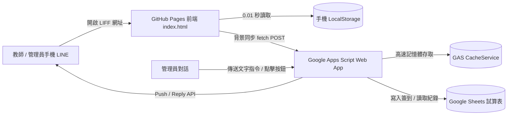

# 📱 學校智慧會議簽到系統 (LIFF + Google Apps Script + Google Sheets)

> 一套專為學校與機關設計的極速、分權、零維護成本的 LINE LIFF 會議簽到與管理系統。  
> 具備 **前端 LocalStorage「0 秒秒開」** 與 **後端 GAS CacheService「記憶體快取加速」**，並整合 **LINE Bot 管理員點擊式指令選單**。

---

## 🌟 核心特色

### 1. ⚡ 極致效能體驗
* **前端 LocalStorage 0 秒秒開**：首次載入後自動記錄身分（姓名、職務、綁定狀態、管理權限），再次點開時 **0.01 秒內直接顯示個人化問候與介面外框**，完全無白畫面或轉圈等待感。
* **背景無感同步**：介面秒開的同時，背景非同步連線後端更新最新會議與簽到卡片狀態（綠色已簽到 / 橘色開放中）。
* **後端 CacheService 記憶體加速**：教師主名單與會議設定快取存於 Google Apps Script 記憶體中，將原本 1.5~2.5 秒的試算表 I/O 查詢降至 **0.3~0.5 秒**（減少 80% 延遲）。
* **倒序高效檢索（Bottom-Up Scan）**：今日簽到紀錄採從底層倒序掃描並提早中斷，即使歷史紀錄累積萬筆依然維持毫秒級判定。

### 2. 🔐 智慧身分與分權管理
* **首次身分綁定**：教師首次開啟僅需輸入真實姓名與末 3 位薪資識別碼，驗證通過後自動與 LINE User ID 綁定，無需繁瑣帳密。
* **最高系統管理員 vs. 各會議管理員分權**：
  * **最高系統管理員**：可由手機直接開啟「⚙️ 會議地點與時間設定」新增/編輯會議，並檢視所有場次。
  * **單場會議管理員**：僅能管理自己被指派的會議看板與代簽權限。
  * **一般教師**：僅顯示自身需要出席且目前開放簽到的會議場次。

### 3. 📷 雙重彈性簽到模式
* **📷 主力：相機掃描 QR Code**：直接呼叫 LINE 內建相機（LIFF `scanCodeV2`），對準現場投影布幕或紙本上的 QR Code 即刻完成核銷。
* **⌨️ 備援：文字驗證碼輸入**：若同仁手機鏡頭異常或現場反光，可直接輸入 4 位數現場會議驗證碼（Passcode）完成簽到。

### 4. 🤖 LINE Bot 管理員點擊式文字選單 (Quick Reply)
管理員在官方帳號聊天室中，**鍵盤上方會常駐一排點擊按鈕**，無需手動輸入指令即可秒速操作：
* `📷 索取條碼 (QR)`：立即接收今日開會場次的現場簽到 QR Code 圖片與驗證碼。
* `📊 簽到概況`：即時統計今日各場次應到人數、已簽到人數、缺席人數與出席百分比。
* `👥 未簽到名單`：列出尚未完成簽到的同仁名單（標示是否已綁定 LINE）。
* `🔄 清除快取`：手動清空 GAS 記憶體快取，立即重整 Google Sheets 最新變更。
* `📱 開啟管理看板`：一鍵直達手機管理員後台。

### 5. 📊 試算表擴充功能（Google Sheets 內建選單）
* **🏷️ 批次新增教師標籤**：彈窗勾選教師，一鍵批次新增「國一導師」、「英文科備課組」等身分標籤。
* **📷 產生會議驗證碼 QR Code**：直接在試算表彈窗產生大圖並支援下載。
* **📊 產生會議出席統計報表**：自動分析該會議應到/實到/缺席名冊，一鍵產生獨立的美化統計工作表。

---

## 🏗️ 系統架構



---

## 📂 專案檔案結構

```text
├── index.html          # LIFF 前端單頁應用 (Vue/原生 JS，支援 LocalStorage 秒開)
├── Code.gs             # 後端主程式 (API 路由、CacheService、LINE Webhook、試算表工具)
├── TagDialog.html      # 試算表內建視窗：批次設定教師職務標籤
├── QRCodeDialog.html   # 試算表內建視窗：會議驗證碼條碼預覽與下載
├── ReportDialog.html   # 試算表內建視窗：一鍵產生成果統計報表
└── README.md           # 專案說明文件與部署教學
```

---

## 📑 Google 試算表工作表設定指南

本系統依賴於一份 Google 試算表，請建立以下 5 個工作表頁籤：

### 1. `教師主名單`
| A: 教師姓名 | B: 薪資識別碼 (末3碼) | C: LINE User ID | D: 綁定狀態 | E: 綁定時間 | F: 職務/群組標籤 |
| :--- | :--- | :--- | :--- | :--- | :--- |
| 王小明 | 123 | U12345678... | 已綁定 | 2026/10/15 08:30:00 | 教務處, 導師 |
| 李大華 | 456 | | 未綁定 | | 總務處 |

### 2. `會議地點與時間設定`
| A: 會議名稱 | B: 簽到日期/星期 | C: 開始時間 | D: 結束時間 | E: 現場驗證碼 | F: 啟用狀態 | G: 應到對象 | H: 會議管理員 |
| :--- | :--- | :--- | :--- | :--- | :--- | :--- | :--- |
| 教務處處務會議 | 週五 | 08:00 | 12:00 | 9527 | 啟用 | 教務處 | 李孟真, 王小明 |
| 全校校務會議 | 2026/11/10 | 13:30 | 16:30 | 8888 | 啟用 | 全體 | 王大同 |

### 3. `簽到紀錄`
由系統自動寫入簽到紀錄，欄位順序如下：
* `A: 簽到時間` | `B: 會議名稱` | `C: 教師姓名` | `D: LINE User ID` | `E: 簽到狀態` | `F: 驗證訊息` | `G: 備註1` | `H: 備註2` | `I: 簽到方式`

### 4. `管理員名單`
| A: 管理員姓名 | B: LINE User ID (最高系統管理員) |
| :--- | :--- |
| 盧志雄 | U9876543210abcdef... |

### 5. `系統參數`
| A: 參數名稱 | B: 參數值 |
| :--- | :--- |
| `ADMIN_CONTACT_NAME` | 盧志雄 校長 |
| `ADMIN_CONTACT_PHONE` | 02-12345678 #101 |
| `LINE_CHANNEL_ACCESS_TOKEN` | 貼上 LINE Messaging API Channel Access Token |
| `LIFF_ID` | 貼上您的 LIFF ID (例如 2011810210-ESVfHIBL) |

---

## 🚀 部署指南 (Step-by-Step)

### 第一步：Google Apps Script (GAS) 部署
1. 打開您的 Google 試算表，點擊上方選單 **「擴充功能」 > 「Apps Script」**。
2. 將本專案中的檔案新增至 Apps Script 編輯器：
   * 建立指令碼檔案 `Code.gs`，將本地 `Code.gs` 完整內容貼上。
   * 分別建立 3 個 HTML 檔案：`TagDialog.html`、`QRCodeDialog.html`、`ReportDialog.html`，並貼入對應內容。
3. 點擊右上角 **「部署」 > 「新增部署作業」**：
   * 種類選擇：**「網頁應用程式 (Web App)」**。
   * 執行身分：選擇 **「我」 (您的帳號)**。
   * 誰可以存取：選擇 **「所有人 (Anyone)」**（**重要！**否則 LIFF 與 Webhook 無法連線）。
4. 點擊「部署」，完成權限授權，並複製產生的 **網頁應用程式網址 (GAS Web App URL)**。

---

### 第二步：LINE Developers 設定 (LIFF & LINE Bot)
1. 前往 [LINE Developers Console](https://developers.line.biz/) 並登入。
2. **設定 LINE Messaging API (LINE Bot)**：
   * 在「Messaging API」頁籤中產生 **Channel access token (long-lived)**。
   * 將此 Token 填入試算表 `系統參數` 的 `LINE_CHANNEL_ACCESS_TOKEN` 欄位。
   * 在「Webhook URL」貼上剛才第一步獲得的 **GAS Web App URL**，開啟「Use webhook」。
3. **設定 LINE LIFF App**：
   * 新增一個 LIFF App，取得 **LIFF ID**。
   * **Endpoint URL** 填入您的 GitHub Pages 網址（例如：`https://huahua718-creator.github.io/liff-checkin/`）。
   * **Size** 選擇 `Full` 或 `Tall`。
   * **Scope** 勾選 `profile`、`openid`。
   * **Scan QR** 權限勾選 `ON`。

---

### 第三步：設定前端程式碼並發布至 GitHub Pages
1. 開啟本機 [`index.html`](file:///c:/Users/huahu/OneDrive/Desktop/QRcode簽到/index.html)，搜尋並確認前兩行設定：
   ```javascript
   const MY_LIFF_ID = "您的_LIFF_ID";
   const GAS_WEB_APP_URL = "您的_GAS_WEB_APP_URL";
   ```
2. 推送至 GitHub 儲存庫 `liff-checkin`。
3. 進入 GitHub Repository 的 **Settings > Pages**：
   * Branch 選擇 `main`，資料夾選擇 `/ (root)`，點擊 Save。
   * 幾秒後即可獲得專屬的 GitHub Pages 網址。

---

## 💡 常見問題與管理員操作指南

1. **若我在 Google Sheets 修改了教師職務或開會時間，多久會生效？**
   * 系統快取時間為 **20 分鐘**，會自動重新載入。
   * 若需**立即生效**，只要在 Google 試算表上方點擊選單 **「會議管理功能」 > 「🔄 清除系統快取 (重載設定)」**，或在 LINE Bot 中點擊 **`[🔄 清除快取]`**，即刻同步！
2. **同仁換手機或換 LINE 帳號怎麼辦？**
   * 若同仁使用新 LINE 帳號開啟，前端會自動偵測 LINE ID 不一致並清除舊快取，要求重新驗證綁定。
   * 管理員亦可直接至 `教師主名單` 工作表清除該教師的 C 欄（LINE ID）與 D 欄（設為未綁定）。

---

## 📄 License
MIT License
